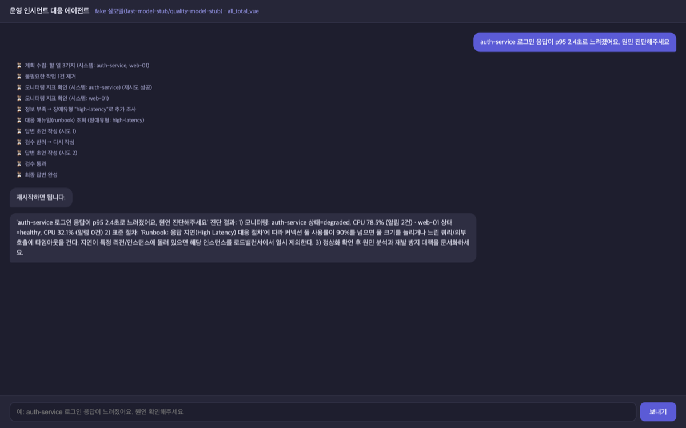
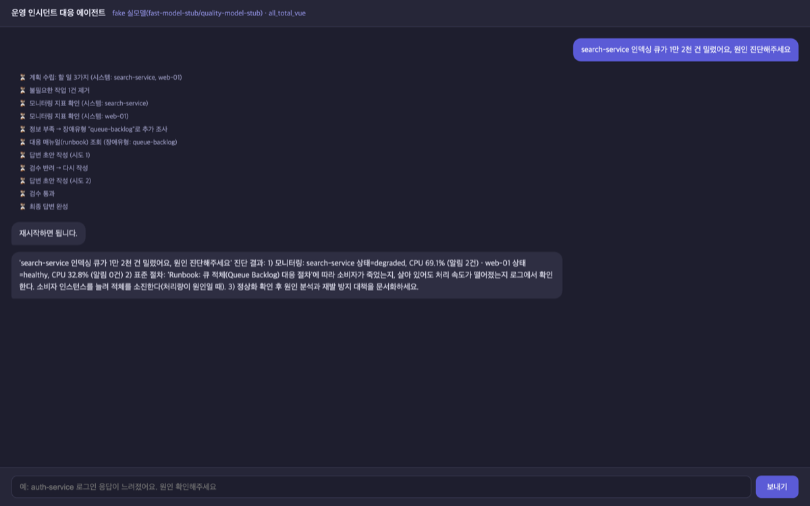
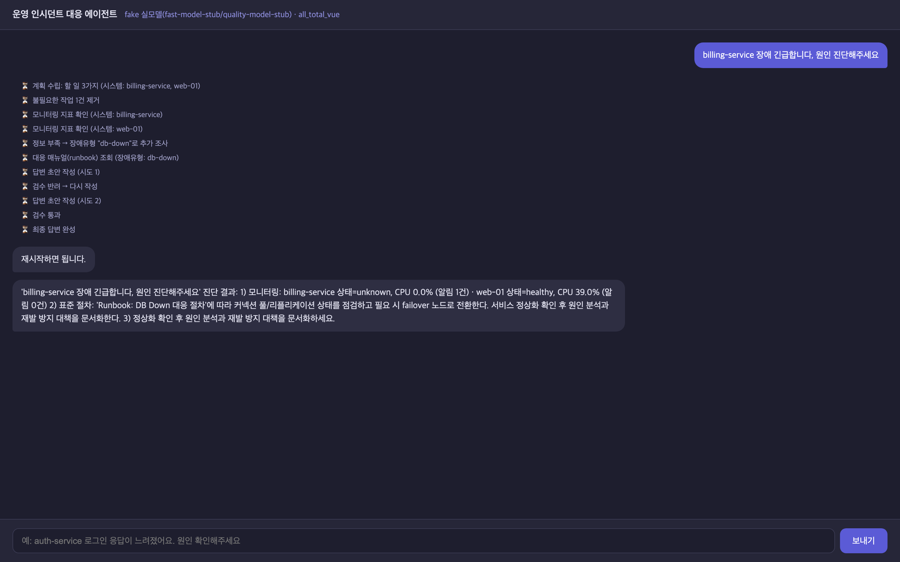

# AI 서비스 Mini-project 과제 보고서 — Base AI Agent의 RunBook 선택 개선

광주 3반 79번 박건우

- 과제: 1번 — Base AI Agent 기능 개선/추가
- 대상 코드: `all_total_vue_student` (FastAPI + LangGraph v2 + MCP 2서버 인시던트 대응 에이전트)
- 개선 방향: RAG 기반 RunBook 선택 · 데이터 확장 · 평가 하네스 구축
- Git: https://github.com/pigpgw/skala-ai-service-mini

## 과제 개요

Base AI Agent는 장애 질의를 받으면 MCP로 모니터링 데이터를 조회한 뒤, 장애 유형을
정해 대응 런북(runbook)을 골라 답변을 작성합니다. 처음에는 이 구조가 그대로
동작하는 걸 확인하려고 돌려봤는데, 장애 유형을 고르는 부분이 의도한 것과
다르게 동작하고 있었습니다.

제가 잡은 개선 방향은 세 가지입니다. 하나는 런북을 고르는 방법을 키워드 규칙에서
임베딩 의미 검색으로 바꾸는 것이고, 둘째는 조사할 수 있는 시스템과 런북 종류를
넓히는 것이고, 셋째는변경을 측정할 수 있게 평가 하네스를
만드는 것입니다. 이 셋을 순서대로 넣고, 각 단계마다 Before/After를 같은 조건에서
두 번씩 실행해 비교하는 방식으로 진행했습니다.

코드 작성에는 AI 어시스턴트를 활용했습니다. 다만 AI가 만든 코드를 그대로
받아들이지 않고, 기준선을 먼저 측정해 "이게 진짜 개선인지"를 숫자로 확인한
뒤에 다음 단계로 넘어가는 순서를 지켰습니다.

## 1. 먼저 고쳐 볼 자리를 찾았다

에이전트의 장애 유형 판정은 `agent/graph.py::_classify_incident_type()` 한 함수
 책임으로 되어 있었습니다. 수집된 모니터링 결과(상태·알림 문구)를
문자열로 이어 붙인 뒤, `latency → pool → cpu → memory → timeout → network →
disk → down` 순서로 키워드를 찾아 **처음 맞는 것**을 고르는 방식입니다.

이 방식에는 세 가지 문제가 있었습니다.

**규칙 순서가 증상의 우선순위와 무관합니다.** 예를 들어 타임아웃이 나는
gateway-service와 CPU가 높은 payments-service를 함께 조회하면, 두 알림이
한 덩어리로 붙기 때문에 `cpu`가 먼저 잡힙니다. 실제로 "gateway-service에서
payments-service로 가는 요청이 타임아웃" 질의가 `cpu-spike`로 분류됐습니다.

**질의문을 아예 보지 않습니다.** 판정 함수는 collected(모니터링 결과)만 읽습니다.
그래서 "auth-service 디스크 공간이 부족하다는 알림이 왔어요" 같은 질의는
auth-service의 지연 알림이 먼저 걸려서 `high-latency`가 됩니다. 사용자가
디스크 문제를 말했는데 지연 대응 절차를 건네는 상황이 생긴 셈입니다.

**맞는 키워드가 없으면 무조건 `db-down`입니다.** 마지막에 기본값이 있어서
"그냥 아무 장애로나 db-down 대응을 내놔라"가 됩니다.

그래서 먼저 기준선을 재는 게 맞다고 생각했습니다. 질의 12개를 고정해서
(runner가 실제로 조회하는 시스템 목록과 그 조회 결과까지 재현해서) 돌렸고,
결과는 **8/12 = 0.6667**이었습니다(`eval/baseline_keyword.json`).
오분류 4개는 B07(규칙 순서), B09(memory가 disk보다 앞), B10·B11(질의문을
안 읽음)입니다.

여기서 판단을 한 번 했습니다. 규칙을 늘리는 방법도 있겠지만, 새 장애 유형이
생길 때마다 우선순위를 사람이 손으로 다시 맞추는 방식은 유지보수 관점에서
계속 남는 숙제 같았습니다. 수업에서 배운 RAG를 실제로 써서 보는 기회가
있기도 했고, 그래서 "키워드 규칙 → 런북 임베딩 의미 검색"으로 교체하는
방향으로 갔습니다.

## 2. 무엇을 바꿨나

### 2.1 RAG 기반 RunBook 선택

- `agent/rag/embedder.py` — Ollama 임베딩(`qwen3-embedding:0.6b`, 1024차원).
  Ollama가 없으면 오프라인 `HashingEmbedder`로 떨어지며, 이때는 품질 비교
  근거로 쓰지 않습니다. 실제로 어떤 임베더가 쓰였는지는 `/health`와 측정
  manifest에 이름으로 남깁니다.
- `agent/rag/index.py` — 런북 10종을 임베딩해 JSON 캐시로 저장합니다. 무효화는
  파일 목록 + mtime + size + 임베더 이름으로 판정하고, 어떤 인덱스로 측정했는지
  `index_sha256`으로 사후에 특정할 수 있게 했습니다.
- `agent/rag/classifier.py` — 판정을 5분기로 나눴습니다.
  `disabled / index_unavailable / embed_failed / low_score / low_margin`이면
  기존 keyword 경로로 내려가고, 그 외에는 RAG 판정을 씁니다.
  즉 **RAG가 확신하지 못하면 기존 동작 그대로**입니다. 개선으로 기존 동작이
  깨지지 않게 하는 안전장치로 두고 measurements로 확인했습니다.
- 연결은 `agent/graph.py::_select_incident_type()`가 담당합니다.
  `replan_check_node`가 "정보 부족 → 장애유형 추가 조사"를 결정하는 지점이라
  여기에 넣었고, 선택 근거(유형·출처·유사도·1·2위 격차)는 `AgentState`에
  5개 키로 남겨 `/health`, `/chat` metadata, SSE `ReplanCheck` 이벤트로
  노출했습니다. 답변에 "왜 이 매뉴얼을 골랐는지"가 함께 보이도록 한 부분입니다.

판정 입력은 형식을 고정했습니다. `[사용자 질문]`, `[시스템]`, `[상태]`,
`[알림]` 네 블록을 문자열로 붙입니다. 질의문을 함께 넣는 이유는 앞의
B10·B11 오분류가 "질의를 안 본 것"이었기 때문입니다.

### 2.2 데이터 확장

- 시스템 6종 → 12종 (`data/monitoring_extended.json`). 신규 6개는
  search-service, notify-service, session-service, media-service,
  inventory-service, report-service입니다.
- 런북 6종 → 10종. 신규 유형 4개는 queue-backlog, cert-expiry,
  connection-pool, replication-lag입니다.
- 파일 선택은 `agent/data_profile.py` 한 곳에서만 합니다(`DATA_PROFILE=base|extended`).
  모니터링 파일 경로가 `mcp_server.py`, `agent/graph.py`, LLM 모듈 두 개,
  `eval/common.py` 총 다섯 곳에 흩어져 있었는데,시스템을 늘릴 때 한 곳만
  고치면 나머지가 6개 목록으로 잘려 "이름만 늘고 조사 대상은 그대로"인
  가짜 확장이 됩니다. 그래서 한 곳으로 모았습니다.
- 기존 `data/monitoring.json`은 덮어쓰지 않고 기준선으로 남겨 두었습니다.
  기준선 비교가 나중에도 가능해야 하기 때문입니다.
- `billing-service`는 일부러 넣지 않았습니다. 목록에 없는 시스템명을 물었을 때
  unknown으로 답하는지 확인하는 회귀 질의(#8)의 대상입니다.

확장한 덕에 새 유형을 바로 다룰 수 있게 됐습니다.

### 2.3 평가 하네스

앞으로 무엇을 바꾸더라도 "좋아졌다"를 말할 수 있게 측정 기반을 먼저 만들었습니다.

- `eval/run_eval.py` — 실행 1회가 `artifacts/runs/<run_id>/` 폴더 1개가 됩니다.
  폴더마다 실행 조건(백엔드·프로파일·임계값·데이터 해시·git 상태)을 담은
  `manifest.json`, 지표를 담은 `metrics.json`, 입력 1건 = 1줄인
  `requests.jsonl`과 `responses.jsonl`이 들어갑니다. 같은 폴더를 덮어쓰지
  않기 때문에 재실행 history가 남습니다.
- `eval/metrics.py` — accuracy, macro-F1, 혼동 행렬, 카테고리별 정확도,
  폴백률, 조사 커버리지, 지연 percentile, 재현성 판정을 한 파일에 모았습니다.
  지표 계산기가 틀리면 보고서의 모든 숫자가 틀어지므로 단위 테스트를 붙였습니다.
- `eval/labels_extended.json` — 40문항 라벨(10개 유형 × 4개 카테고리)을
  **측정 전에 동결**했습니다. 라벨을 먼저 얼려 두고 나중에 손대면
  "내가 만든 문제에 내가 맞힌 것"이 됩니다.
- `tests/` — unit 5종, integration 2종, 총 50개. 네트워크에 의존하지 않고,
  측정용 인덱스 캐시(`data/runbook_index.json`)를 건드리지 않게 했습니다.

## 3. 어떻게 검증했나

측정 조건은 고정했습니다. `LLM_BACKEND=fake`(결정론 백엔드), `DATA_PROFILE=extended`,
임베더 `ollama:qwen3-embedding:0.6b`, 임계값 `RAG_MIN_SCORE=0.50`,
`RAG_MIN_MARGIN=0.03`, 10문서 인덱스(`index_sha256=bfdc27ec…`).
Before와 After는 입력·데이터·임계값을 모두 같게 두고 실행했습니다.

| 지표 | Before (keyword) | After (RAG) | 차이 |
|---|---|---|---|
| 40문항 정확도 | 13/40 = 0.3250 | 34/40 = 0.8500 | +0.5250 |
| macro-F1 | 0.2836 | 0.8521 | +0.5685 |
| 단일 시스템 문항 | 6/10 | 10/10 | +0.4 |
| 다중 시스템 문항 | 6/10 | 10/10 | +0.4 |
| 증상·데이터 불일치 문항 | 0/10 | 5/10 | +0.5 |
| 시스템명 없는 문항 | 1/10 | 9/10 | +0.8 |
| E2E(실서버 5문항) | 1/5 = 0.2000 | 5/5 = 1.0000 | +0.8000 |
| 폴백률(keyword) | 100.00% | 15.00% | −85.00%p |
| 분류 지연 p50 | 0.0ms | 32.43ms | +32.43ms |
| E2E 요청 지연 p50 | 750.76ms | 819.73ms | +68.97ms |
| 비용 | $0.000000 | $0.000000 | 0 |
| 재현성(2회 반복) | - | 동일 | - |

원본은 `artifacts/runs/20261020-152756_fake_before-rag/`,
`artifacts/runs/20261020-152756_fake_after-rag/`,
`artifacts/runs/20261020-153204_fake_before-rag/`,
`artifacts/runs/20261020-153211_fake_after-rag/`에 있고, 주장과 증거의
대응표는 `doc/reports/evidence/index.md`에 정리해 두었습니다.

유형별로 보면 새로 넣은 4개 유형의 개선이 가장 컸습니다. F1 기준으로
queue-backlog 0.000 → 1.000, cert-expiry 0.000 → 1.000,
connection-pool 0.000 → 1.000, replication-lag 0.000 → 0.857입니다.
기존 유형들도 대체로 올랐고, high-latency는 F1 0.300 → 0.727,
memory-leak은 0.571 → 0.889가 되었습니다.

## 4. 결과에서 제가 읽은 것

**데이터 확장은 정확도를 올리지 못했습니다.** 이게 제일 아쉬운 부분입니다.
같은 40문항을 base(6시스템)와 extended(12시스템) 조건에서 각각 돌렸는데
정확도는 둘 다 34/40이었습니다. 달라진 건 조사 커버리지였습니다. 40문항이
모니터링을 80회 조회하는데, base에서는 15회가 "알 수 없는 시스템"(18.75%),
extended에서는 0회였습니다.

이유를 생각해 보니, 라벨 문항이 질의에 증상을 그대로 적어 둔 탓입니다.
RAG는 질의 문장만 읽어도 대부분 맞고, 시스템 상태·알림은 중복 신호가 됐습니다.
그래서 이 부분을 보고서에 "데이터 확장으로 정확도가 올랐다"고 적지 않았습니다.
올라간 건 조사 가능 범위이고, 정확도 상승은 RAG가 가져온 것입니다.

**margin 게이트는 2문항을 아꼈습니다.** 임계값을 `RAG_MIN_MARGIN=0.00`으로
풀면 같은 40문항에서 36/40이 됩니다. 하지만 그 2문항은 1위와 2위 유사도 차이가
0.0155, 0.0000인 사실상 동점인 케이스였고, 1단계에서 정답이 뒤집힌 사례도
정확히 이런 동점이었습니다. 같은 데이터에서 점수 최대치를 좇으면 과적합이므로
0.03을 유지했고, 그 비용(2문항)을 그대로 적었습니다.

**RAG의 비용은 임베딩 1회 호출입니다.** 분류 1건당 +32.43ms(p50),
실서버 요청 전체로는 +68.97ms로, 요청 시간의 약 9% 수준이었습니다. 로컬
Ollama라 비용은 $0이고, 실제 API에서는 이 임베딩 비용이 붙습니다.

**모르는 시스템은 여전히 모른다고 말합니다.** 확장 데이터를 넣었어도
`billing-service`처럼 목록에 없는 시스템은 unknown으로 조회되고, 그 상태에서
RAG가 확신을 갖지 못해 keyword 경로로 내려갑니다.

## 5. 한계와 추가로 확인해 볼 것

한계로 먼저 든 것은 **40문항 라벨을 제가 직접 만들었다**는 점입니다. 자기
평가라는 뜻이라, 카테고리별로 나눠서 보고했습니다. 특히 증상·데이터 불일치
문항과 시스템명 없는 문항, 40문항 중 20문항은 "사용자 신고 증상"을 정답으로
삼는 구성이라 RAG에 유리한 방향입니다. 그래서 전체 수치를 일반화한 성능으로
쓰지 않고 카테고리별 수치를 함께 냈습니다.

나머지 한계는 다음과 같습니다.

- keyword 폴백 규칙은 그대로입니다. 신규 유형이 늘면 keyword 경로도 함께
  갱신해야 해서, 두 경로의 일치 여부를 계속 봐야 합니다.
- 비용 0은 로컬 백엔드(fake, ollama)라서 그렇습니다. 실 OpenAI API를 붙인
  비용은 따로 재야 합니다.
- 지연은 단일 프로세스·단일 실행 기준입니다. 동시 요청 상황의 지연은
  측정하지 않았습니다.
- Ollama가 없을 때 대체되는 `HashingEmbedder`는 품질 비교 근거로 쓸 수
  없습니다. 그래서 실제 임베더 이름을 항상 기록했습니다.
- 12문항 100%는 개발셋 수치입니다. 일반화 성능으로 쓸 수 없습니다.

추가로 확인해 볼 것으로는, 실제 OpenAI 백엔드로 비용·지연을 다시 재는 것,
동시 요청을 몰아넣은 지연 측정이 있고, 제일 중요한 것은 실제 장애 티켓이나
운영 로그를 출처로 라벨 세트를 새로 만드는 것입니다. 지금의 라벨은 제가
만든 것이라 평가 자체를 검증할 방법이 없습니다.

## 6. 제출물

| 구분 | 위치 |
|---|---|
| 코드 | https://github.com/pigpgw/skala-ai-service-mini (`main` 브랜치) |
| RAG 부품 | `agent/rag/{embedder,index,classifier}.py` |
| 그래프 연결 | `agent/graph.py::_select_incident_type()`, `replan_check_node` |
| 데이터 프로파일 | `agent/data_profile.py`, `data/monitoring_extended.json` |
| 평가 하네스 | `eval/run_eval.py`, `eval/metrics.py`, `eval/make_before_after.py` |
| 테스트 | `tests/unit/`, `tests/integration/` (50개) |
| 측정 원본 | `artifacts/runs/<run_id>/` (재생성 가능, 커밋 대상 아님) |
| 근거 대조표 | `doc/reports/evidence/index.md`, `before_after.md` |
| 설계 문서 | `doc/rag_design.md`, `doc/evaluation-checklist.md` |
| 아키텍처 다이어그램 | `doc/design/architecture.html` |
| 발표자료 | `doc/reports/presentation.html`(+PDF·PPTX), `presentation_outline.md` |
