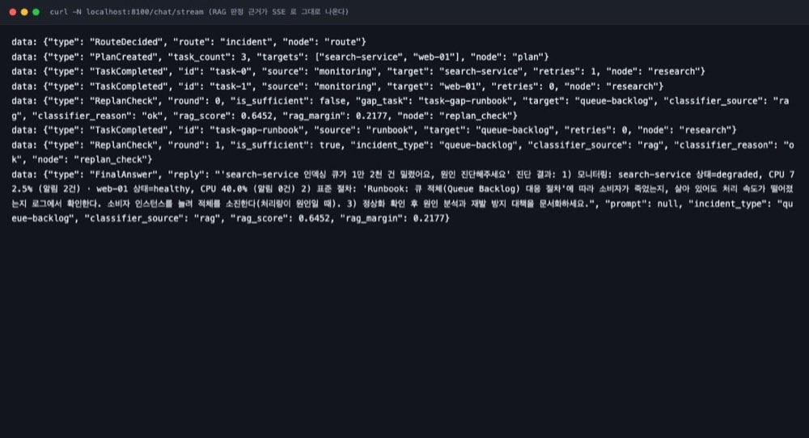
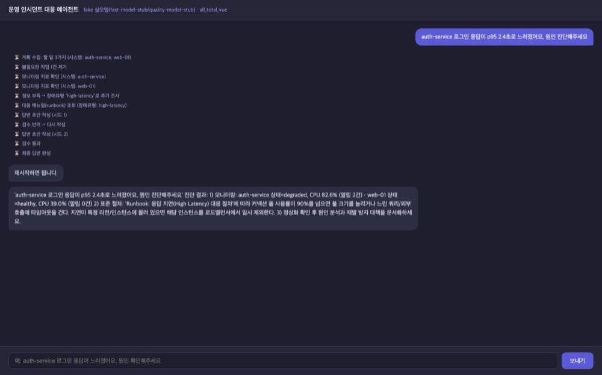
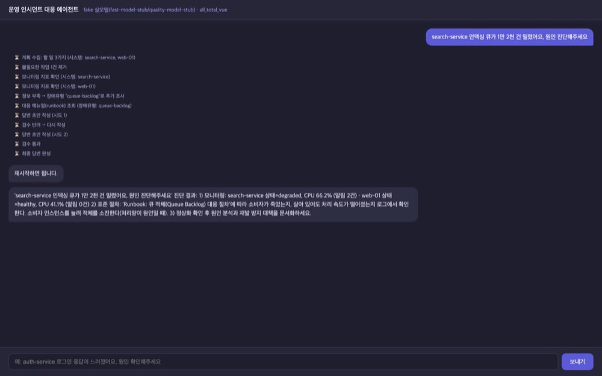
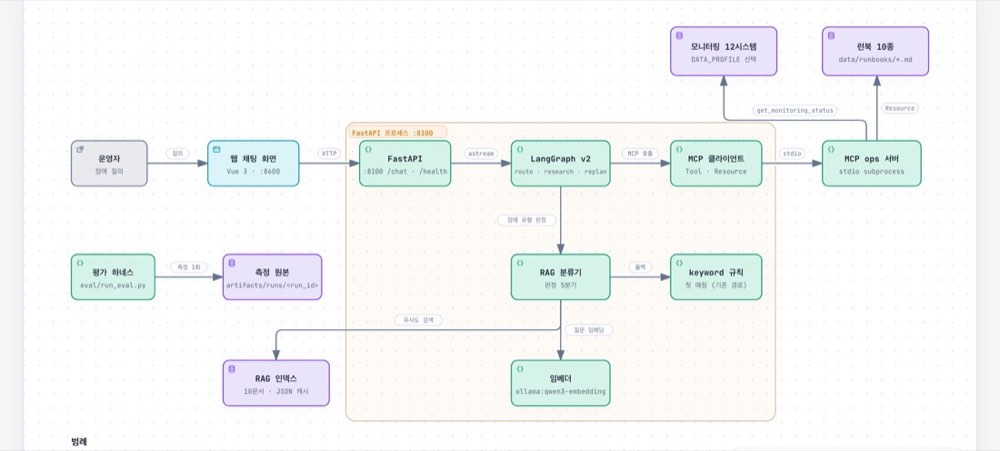
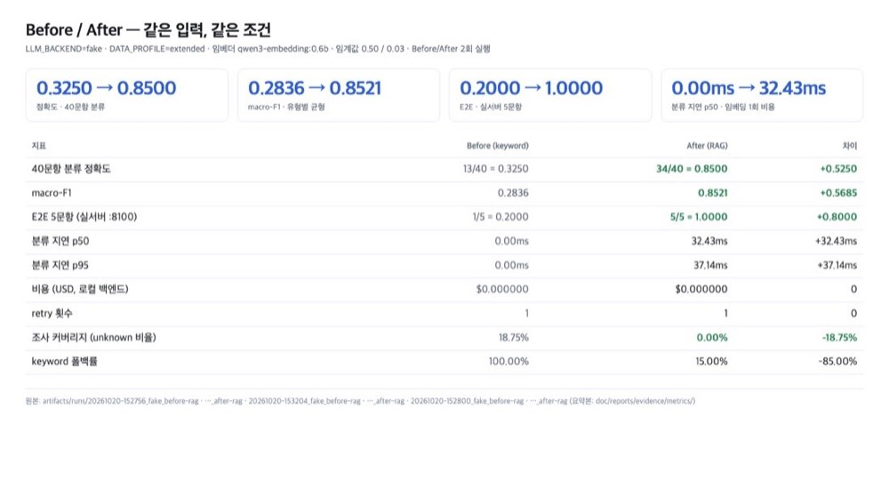

# AI 서비스 Mini-project 과제 보고서 — Base AI Agent의 RunBook 선택 개선

**79번 박건우** (G079 · 광주 3반)

- 선택 과제: **1번 — Base AI Agent 기능 개선/추가**
- 대상 코드: `all_total_vue_student` (FastAPI + LangGraph v2 + MCP 2서버 인시던트 대응 에이전트)
- Git 주소: https://github.com/pigpgw/skala-ai-service-mini
- 발표자료: `AI서비스_Mini_발표자료_3반_박건우.pdf` (5분 = 2분 + 3분)

---

## 1. 진행 사항 소개

### 1.1 어떤 과제인지

기존 Base AI Agent는 장애 질의를 받으면 MCP로 모니터링 데이터를 조회하고, 장애 유형을 정한 뒤
그에 맞는 대응 런북(runbook)을 골라 답변을 만듭니다. 파이프라인은
`route → plan → gate → research → replan_check → analysis → write → validate → finalize`이고,
제가 손댄 자리는 단 하나입니다. **장애 유형을 정하는 그 한 줄.**

### 1.2 추가·수정한 task 4개

| # | task | 무엇을 바꿨는지 | 어디에 있는지 |
|---|---|---|---|
| 1 | **RAG 기반 RunBook 선택** | 키워드 규칙을 순서대로 보다가 **처음 맞는 것**을 고르는 방식 → 런북 10종을 임베딩해 **의미상 가까운 것**을 고르게 변경. 확신이 없으면 기존 keyword 경로로 폴백 | `agent/rag/{embedder,index,classifier}.py`, `agent/graph.py::_select_incident_type()` |
| 2 | **라우팅 기준 확대** | 결정론 백엔드의 라우팅 정규식이 키워드 7개뿐이라, 매뉴얼이 알려준 예시 질의 7개가 `chat`으로 떨어져 장애 파이프라인이 돌지 않았다. 운영 어휘로 넓히고 시스템명 언급 시 장애로 | `agent/fake_llm.py::route` |
| 3 | **데이터 확장** | 모니터링 6→12시스템, 런북 6→10종(신규 유형 queue-backlog·cert-expiry·connection-pool·replication-lag). 파일 선택은 한 곳에서만 | `agent/data_profile.py`, `data/monitoring_extended.json`, `data/runbooks/` |
| 4 | **평가 하네스** | 실행 1회 = 폴더 1개(`artifacts/runs/<run_id>/`)로 조건·지표·입출력을 남기고, 40문항 라벨을 측정 전에 동결, PDF 9쪽 회귀 질의 10개를 실제 서버로 돌리는 실행기, **문서에 적힌 숫자가 원본과 같은지 기계로 대조하는 검사기** | `eval/run_eval.py`, `eval/metrics.py`, `eval/run_regression_queries.py`, `eval/check_reported_numbers.py`, `tests/` |

### 1.3 고치기 전에 무엇이 틀렸는지 먼저 재봤다

개선을 시작하기 전에 기준선을 먼저 재기로 했습니다. "그래서 고쳤더니 좋아졌다"는 말이
검증 없이 나올까봐요. 질의 12개를 고정해서 돌렸더니 **8/12 = 0.6667**이었고, 오분류 4개를
코드 위치까지 추적했습니다.

- **B07** — gateway-service(타임아웃)와 payments-service(CPU)를 함께 조회하면, 알림이 한 덩어리로
  붙어 있어서 규칙 순서상 `cpu`가 먼저 잡혔습니다. **규칙 순서와 증상 우선순위가 무관**하다는 뜻이었습니다.
- **B09** — `memory`가 `disk`보다 앞에 있어서 디스크 문제인데 메모리 대응 절차가 나갔습니다.
- **B10·B11** — 판정 함수가 질의문 자체를 보지 않습니다. "auth-service 디스크 공간이 부족하다는
  알림이 왔어요" 같은 질의가 auth-service의 지연 알림에 가려 `high-latency`가 됐습니다.
- **매칭 실패 시 무조건 `db-down`** — "아무 장애나 db-down 대응을 내놔라"가 되는 구조였습니다.

여기서 판단이 하나 나왔습니다. 규칙을 계속 늘리는 방법도 있겠지만, 새 장애 유형이 생길 때마다
사람이 우선순위를 다시 맞추는 건 계속 남는 숙제 같았습니다. 수업에서 배운 RAG를 실제로 써서
보는 기회도 있었고, 그래서 의미 검색으로 교체했습니다.

### 1.4 라우팅 공백 — 마지막에야 발견한 것

개선 4개 축을 다 넣고 나니 과제 매뉴얼 9쪽이 알려준 테스트 질의 10개를 실제로 돌려 봤습니다.
**10개 중 3개만 통과**했습니다. 7개가 `chat`으로 떨어져서 "안녕하세요! 무엇을 도와드릴까요?"만
답하고 있었습니다.

원인은 제가 고친 판정이 아니라 **입구**였습니다. 결정론 백엔드(`agent/fake_llm.py`)의 라우팅
정규식이 `장애|진단|다운|지연|급증|incident|티켓` 7개짜리였고, 매뉴얼의 예시 질의 중 7개가
그 정규식에 걸리지 않았습니다. 실제 LLM 백엔드(ollama/openai)는 "장애·성능 저하·지연·진단·모니터링·티켓"을
프롬프트로 분류하기 때문에 이 문제가 없는데, 결정론 백엔드만 좁았습니다.

**즉 과제가 알려준 테스트 질의로 자기 자신을 테스트할 수 없는 상태였습니다.** 처음부터
매뉴얼의 테스트 방법대로 따라갔어야 했습니다. 라우팅 기준을 실제 LLM 백엔드와 같은 운영
어휘로 넓히고, 모니터링 대상 시스템명이 있으면 장애로 가게 했습니다(목록에 없는 `billing-service`도
포함 — 8번 질의가 그렇게 요구합니다). 잡담과 세션 기억 질문은 그대로 `chat`입니다.

---

## 2. 사용한 기술 요소

### 2.1 기술 요소별 구현 위치

| 기술 요소 | 구현 위치 | 이번 과제에서 한 것 |
|---|---|---|
| **Multi-Agent / LangGraph** | `agent/graph.py` StateGraph (노드 10개), `agent/supervisor_v1.py` legacy 선형 | 그래프 구조는 유지. `replan_check`가 장애 유형을 정하는 지점의 **판정 함수만 교체** |
| **MCP** | `mcp_server.py`(ops 서버 — Tool·Resource·Prompt 실사용), `agent/mcp_client.py`(stdio subprocess 클라이언트) | 서버는 그대로 쓰고, **어느 데이터를 볼지**(프로파일)와 **판정 결과 근거를 어디로 내보낼지**를 늘림. `mcp_server_docs.py`는 decoy라 쓰지 않음 |
| **RAG** | `agent/rag/embedder.py`·`index.py`·`classifier.py` | **신규 구현.** Ollama 임베딩(`qwen3-embedding:0.6b`, 1024차원), 10문서 JSON 인덱스 캐시, 5분기 게이트 |
| **의존성 주입** | `agent/deps.py`의 `SupervisorDeps`에 `rag` 필드 추가, `server.py` lifespan에서 1회 생성 | RAG 분류기를 deps로 넘김 → 노드가 `os.environ`을 직접 읽지 않음 |
| **LangSmith** | `agent/graph.py` 노드에 `@traceable`, `.env.example`의 `LANGCHAIN_TRACING_V2`·`LANGCHAIN_PROJECT` | 트레이싱 켜는 경로 확보. **실 API 키 없는 환경이라 이번 실행에서는 캡처하지 못했습니다** |
| **모듈화** | `agent/`(llm·graph·mcp·retry·rag·session_store), `eval/`(평가 코드), `doc/tools/`(문서 생성 도구), `tests/` | RAG을 `agent/rag/`로 분리하고, 경로 하드코딩 5곳을 `agent/data_profile.py` 한 곳으로 모음 |
| **단위 테스트** | `tests/unit/` 6종 + `tests/integration/` 2종 | **신규 65개.** 라우팅 분기·RAG 게이트·keyword 고정까지 핀으로 고정 |

### 2.2 기능 캡처 — 판정 근거가 그대로 나온다

`replan_check`는 "모니터링 정보만으로는 부족해 런북이 필요하다"고 판단하고 런북을 추가로 조회합니다.
그 판단의 근거(어떤 런북인지, 유사도 점수, 1·2위 격차)가 SSE 이벤트로 그대로 나갑니다.
아래는 실제 `curl -N localhost:8100/chat/stream` 출력입니다.

`"classifier_source": "rag"`, `"rag_score": 0.6452`, `"rag_margin": 0.2177`이 그대로 보입니다.
같은 값이 `/chat` 응답의 `metadata`에도 들어가고, `/health`의 `rag` 블록에는 임베더·인덱스·임계값이
함께 노출됩니다. **왜 이 런북을 골랐는지 설명하지 않아도 근거가 남는 구조**로 만들고 싶었습니다.

### 2.3 최종 실행 화면

브라우저 채팅 화면(`http://localhost:8600`)에서 "auth-service 로그인 응답이 p95 2.4초로
느려졌어요, 원인 진단해주세요"를 보낸 결과입니다. 조사 수집 → 정보 부족 → 장애유형 추가 조사 →
대응 매뉴얼 조회 → 초안 작성 → 검수 → 최종 답변까지 순서대로 보입니다.

확장한 데이터로 처음 조사되는 시스템도 같은 화면으로 확인됩니다. `search-service`는 새로 넣은
유형이라 `queue-backlog` 대응 절차가 조회됩니다.

### 2.4 개선의 구조 (아키텍처)

중앙의 `LangGraph v2`가 `replan_check`에서 `RAG 분류기`로 내려가고, 확신이 없으면 `keyword 규칙`
으로 빠지는 갈래가 보입니다. 그 옆이 MCP 클라이언트 → MCP ops 서버 → 모니터링/런북으로 가는 경로이고,
왼쪽 아래가 평가 하네스(`eval/run_eval.py` → `artifacts/runs/<run_id>/`)입니다. 밑줄로 들어가는
`RAG 인덱스`와 `임베더`가 판단의 근거가 됩니다.

---

## 3. 선택 사항 — Before / After 실측 비교

같은 입력, 같은 백엔드, 같은 조건에서 2회 실행해 비교했습니다.
조건: `LLM_BACKEND=fake`, `DATA_PROFILE=extended`, 임베더 `ollama:qwen3-embedding:0.6b`,
임계값 `RAG_MIN_SCORE=0.50`·`RAG_MIN_MARGIN=0.03`, 10문서 인덱스(`index_sha256=bfdc27ec…`).

| 지표 | Before (keyword) | After (RAG) | 차이 |
|---|---|---|---|
| **검색 정확도** — 40문항 분류 정확도 | 13/40 = 0.3250 | 34/40 = 0.8500 | +0.5250 |
| macro-F1 | 0.2836 | 0.8521 | +0.5685 |
| E2E 5문항 (실서버 :8100) | 1/5 = 0.2000 | 5/5 = 1.0000 | +0.8000 |
| 회귀 질의 10문항 (매뉴얼 9쪽) | 3/10 | 10/10 | +0.7000 |
| **지연시간** — 분류 지연 p50 | 0.0ms | 32.43ms | +32.43ms |
| E2E 요청 지연 p50 | 750.76ms | 819.73ms | +68.97ms |
| **비용** (USD, 로컬 백엔드) | $0.000000 | $0.000000 | 0 |
| **retry 횟수** | 1 | 1 | 0 |
| 조사 커버리지 (unknown 비율) | 18.75% | 0.00% | −18.75%p |
| keyword 폴백률 | 100.00% | 15.00% | −85.00%p |

원본은 `artifacts/runs/`에 있고, 인용한 6개 실행의 요약본은 `doc/reports/evidence/metrics/`,
주장↔증거↔재현 명령 대조표는 `doc/reports/evidence/index.md`입니다.
문서에 적힌 숫자가 원본과 어긋나지 않는지 `eval/check_reported_numbers.py`가 자동으로 대조합니다
(현재 15개 주장 15/15 일치).

유형별로 보면 새로 넣은 4개 유형의 개선이 가장 컸습니다. F1 기준으로
queue-backlog 0.000 → 1.000, cert-expiry 0.000 → 1.000, connection-pool 0.000 → 1.000,
replication-lag 0.000 → 0.857입니다.

### 3.1 결과에서 제가 읽은 것 (한계 포함)

- **데이터 확장(6 → 12시스템)은 분류 정확도를 올리지 못했습니다.** base 34/40 ≡ extended 34/40으로
  문항 단위로 동일했습니다. 라벨 문항이 질의에 증상을 그대로 적어 둔 탓에 RAG가 질의만 읽어도
  대부분 맞았고, 시스템 상태·알림은 중복 신호가 됐습니다. 그래서 "데이터 확장으로 정확도가 올랐다"고
  쓰지 않았습니다. 바뀐 건 조사 가능 범위였습니다 — 40문항이 조회한 모니터링 80회 중 데이터가
  없어 못 본 15회가 0회가 됐습니다(unknown 18.75% → 0%).
- **margin 게이트는 2문항을 아꼈습니다.** 임계값을 0으로 풀면 같은 40문항에서 36/40이 되는데,
  그 2문항은 1·2위 유사도 차이가 0.0155·0.0000인 사실상 동점이고, 1단계에서 정답이 뒤집힌
  사례도 정확히 이런 동점이었습니다. 같은 데이터에서 점수 최대치를 좇으면 과적합이므로 0.03을
  유지하고 비용을 그대로 적었습니다.
- **RAG의 비용은 임베딩 1회 호출입니다.** 분류 1건당 +32.43ms, 실서버 요청 전체로는 +68.97ms로
  요청 시간의 약 9% 수준이었습니다. 로컬이라 비용은 $0이고, 실 API에서는 이 임베딩 비용이 붙습니다.
- **keyword 경로에 결함이 하나 남았습니다.** 회귀 질의 #4(gateway 타임아웃 + payments CPU)는
  keyword 경로에서 `cpu-spike`가 됩니다. 규칙 순서 문제(기준선 B07과 같은 원인)이고, RAG를 켜면
  `network-timeout`으로 고쳐집니다.
- **40문항 라벨을 제가 직접 만들었습니다.** 자기 평가가 됩니다. 그래서 질의 의존도가 높은
  20문항(증상·데이터 불일치, 시스템명 없음)을 따로 두고 카테고리별 정확자를 함께 냈습니다.
  전체 수치를 일반화 성능으로 쓰지 않습니다.

---

## 4. 느낀 점 / 이후에 반영하고 싶은 것

### 4.1 느낀 점

**RAG가 아니고, "무엇을 넣을지"와 "언제 안 믿을지"가 구현이었습니다.** 수업에서 RAG는
"벡터 DB에 넣어두고 검색한다"는 설명으로 들었는데, 실제로 해 보니까 임베딩보다 정의가 중요했습니다.
무엇을 입력으로 넣을지(질의문·시스템·상태·알림), 언제 RAG를 믿고 언제 안 믿을지
(score·margin 하한), 근거를 어떻게 남길지(metadata·SSE·manifest) — 이 세 가지가 사실상 전부였다.
특히 "RAG가 확신하지 못하면 예전 경로로 내려간다"는 게이트 하나를 넣고 나서야 기존 동작이
깨지지 않는다는 걸 확신할 수 있었습니다. 게이트가 없으면 개선이 기존 흐름을 망가뜨릴 수 있는데,
그림자가 아니라 숫자로 확인해야 했습니다.

**개선이라고 말하려면 기준선이 먼저였습니다.** 처음에 "이렇게 바꾸면 좋아질 것 같다"로 시작했다가
어디서부터 손댈지 애매해서 막막했습니다. 그러다가 12문항을 고정해서 돌려 보니 4개가 틀린 걸
찾았고, 그 4개가 전부 코드 위치로 설명되는 문제였어요. 그 뒤로 "뭘 고쳤나"보다 "왜 그게
문제였나"를 먼저 찾는 순서가 훨씬 빠르다는 걸 배웠습니다.

**이번 과제에서 제일 아쉬웠던 건, 매뉴얼 9쪽의 테스트 질의를 마지막에야 돌려 봤다는 점입니다.**
개선을 다 넣고 나서야 "테스트 질의 7개가 chat으로 떨어진다"는 게 보였습니다. 전부 정상처럼
돌아가고 있었거든요. 입구가 막혀 있으면 아무리 안쪽을 잘 만들어도 조용히 통과합니다. 처음부터
매뉴얼의 테스트 방법 그대로 따라갔어야 했고, 이건 다음 과제에서 먼저 하겠습니다.

**또 하나 배운 건, 근거를 화면에 남기는 게 말로 설명하는 것보다 낫다는 점입니다.** SSE로
`rag_score`·`rag_margin`이 튀어나오는 걸 보니, 왜 이 런북을 골랐는지를 제가 설명하지 않아도
누군가 확인할 수 있었습니다. 나중에 제가 이 코드를 처음 보면 그때도 같은 판단을 할 수 있을
겁니다.

### 4.2 이후에 반영하고 싶은 것

1. **실제 장애 티켓·운영 로그로 라벨 세트를 다시 만들겠습니다.** 지금 라벨은 제가 만든 자기 평가라
   가장 약한 부분입니다. "평가가 실제와 맞는가"를 확인할 방법이 아직 없습니다.
2. **LLM-as-judge 평가를 넣겠습니다.** 지금은 정답 유형만 채점합니다. "수집한 수치를 답변에 정확히
   인용했는가"를 LLM으로 채점하면 답변 품질까지 볼 수 있습니다.
3. **Research 서브그래프를 쪼개겠습니다.** 단일 `research_node`를 로그 분석·메트릭 분석·런북 분석
   세 개의 서브에이전트로 나누면 멀티에이전트 구조의 이점을 더 크게 볼 수 있습니다.
4. **Human-in-the-loop 승인 노드를 넣겠습니다.** LangGraph `interrupt()`로 위험한 조치(서비스 재시작
   제안)를 최종 응답에 포함하기 전에 사람 승인을 받는 쪽입니다. 자동 응답의 위험을 낮추는
   설계입니다.
5. **메모리 Context를 압축하겠습니다.** 대화가 10턴 이상 쌓이면 과거 턴을 요약해 토큰 비용과
   컨텍스트 크기를 줄이는 쪽입니다. 지금은 세션 DB에 그대로 쌓이고, `session_store.py`를
   `var/session.db`로 옮긴 것만 했습니다.
6. **실 OpenAI 백엔드로 비용·지연을 다시 재겠습니다.** 지금의 비용 $0은 로컬(fake·ollama)이라서
   그렇습니다. 또 동시 요청을 몰아넣은 상황의 지연도 재야 합니다. 이번에 측정한 32ms는
   단일 요청 기준이라 실제 부하에서는 다를 수 있습니다.

### 4.3 제출물

| 구분 | 위치 |
|---|---|
| 코드 | https://github.com/pigpgw/skala-ai-service-mini (`main`) |
| RAG / 라우팅 / 데이터 / 평가 | `agent/rag/`, `agent/fake_llm.py`, `agent/data_profile.py`, `eval/` |
| 테스트 | `tests/unit/`, `tests/integration/` (65개) |
| 측정 원본 | `artifacts/runs/<run_id>/` (재생성 가능) |
| 근거 대조표 | `doc/reports/evidence/index.md` |
| 설계 문서 | `doc/rag_design.md`, `doc/evaluation-checklist.md` |
| 발표자료 | `doc/reports/presentation.pdf`(+PPTX) |
